<!-- Reading the source? Every graphic on this page is generated by scripts/ and refreshed by GitHub Actions. -->

<a href="https://mella7.me">
  <picture>
    <source media="(prefers-color-scheme: dark)" srcset="dark_mode.svg">
    
  </picture>
</a>

  <a href="https://www.linkedin.com/in/MellahMedAli"><picture><source media="(prefers-color-scheme: dark)" srcset="assets/buttons/linkedin-dark.svg">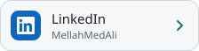</picture></a>
  <a href="https://medium.com/@mellahmohamedali"><picture><source media="(prefers-color-scheme: dark)" srcset="assets/buttons/medium-dark.svg">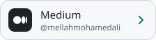</picture></a>
  <a href="https://mella7.me"><picture><source media="(prefers-color-scheme: dark)" srcset="assets/buttons/website-dark.svg"></picture></a>
  <a href="mailto:med.ali@mella7.me"><picture><source media="(prefers-color-scheme: dark)" srcset="assets/buttons/email-dark.svg"></picture></a>

## Hi, I'm Mohamed Ali

I'm a cloud security engineer from Tunisia, based in Germany. I work on Kubernetes platforms, mostly on the part people skip until something breaks: what a container is really doing once it runs, and how much a pipeline or a service account is allowed to touch.

I hold CKA, CKAD, RHCSA and eJPT, and I'm preparing CKS. In 2026 I spoke at ContainerDays Hamburg and the Cloud Identity Summit, and won the Global 1st Prize in the Computing Track of the Huawei ICT Competition in Shenzhen.

> **I'm looking for a junior or working student role** in DevOps, DevSecOps or platform engineering. Switzerland, Luxembourg or Germany, and I'm open to other places for the right team. I work in English and French, and my German is at B1. The fastest way to reach me is [med.ali@mella7.me](mailto:med.ali@mella7.me).

## Things I built

<table>
  <tr>
    <td width="50%" valign="top">
      
      <h3><a href="https://github.com/mella7/project-claim">ProjectClaim</a></h3>
      A Kubernetes operator for self-service namespaces on OpenShift, OKD and plain Kubernetes. A team writes one small claim and gets a namespace with its quota, role bindings, Pod Security level and network isolation, charged to the team's budget. Edit any of it by hand and the operator puts it back within about a second.
        
      Go · controller-runtime · CRDs · CEL validation
    </td>
    <td width="50%" valign="top">
      
      <h3><a href="https://github.com/mella7/cloudstack-dc">cloudstack-dc</a></h3>
      A self-service portal for an Apache CloudStack lab. You draw networks and machines on a canvas, the portal writes the Terraform and shows you the plan, and nothing is created until a person approves it. Quotas and policies are checked while you draw.
        
      Python · FastAPI · React · Terraform
    </td>
  </tr>
</table>

On my desk right now: an MCP server that triages Falco alerts and joins them with RBAC, and `mcp-sentinel`, a least-privilege auditor for MCP servers running in Kubernetes. Both grew out of the talks below.

## Talks

  <a href="https://mella7.me/en/talks/containerdays-2026-ebpf"></a>
   A few slides from the ContainerDays talk. Click through for the full deck.

  <a href="https://mella7.me/en/talks/containerdays-2026-ebpf"><picture><source media="(prefers-color-scheme: dark)" srcset="assets/talks/containerdays-2026-dark.svg">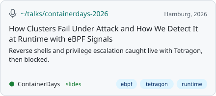</picture></a>
  <a href="https://mella7.me/en/talks/cloud-identity-summit-2026-cicd"><picture><source media="(prefers-color-scheme: dark)" srcset="assets/talks/cloud-identity-summit-2026-dark.svg">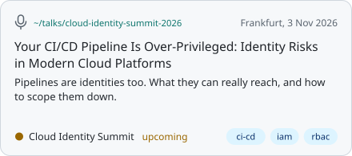</picture></a>

## Stack

  <a href="https://mella7.github.io/mella7/"><picture>
    <source media="(prefers-color-scheme: dark)" srcset="assets/stack-sphere-dark.svg">
    
  </picture></a>
   Click the sphere for the interactive version: drag to spin, hover a logo, filter by group.

## GitHub activity

<picture><source media="(prefers-color-scheme: dark)" srcset="profile-3d-contrib/profile-night-rainbow.svg">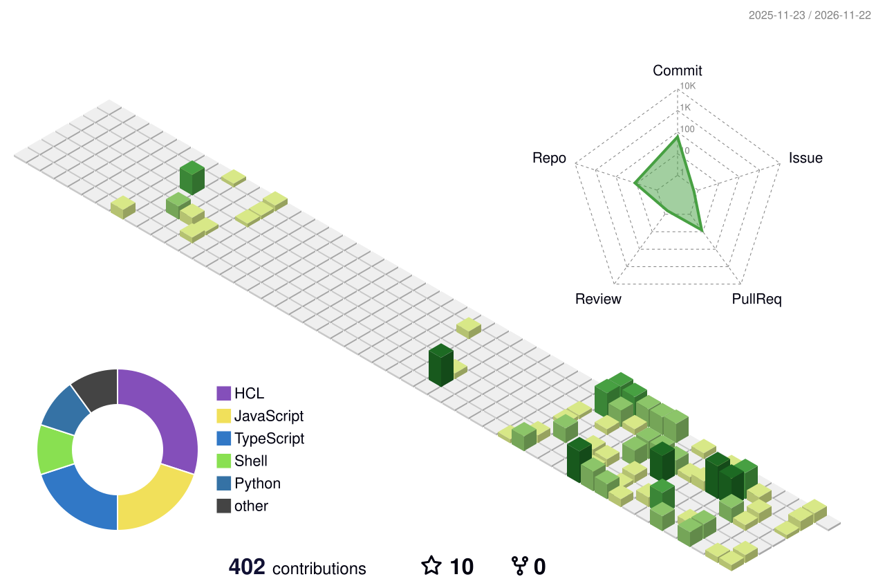</picture>

<picture><source media="(prefers-color-scheme: dark)" srcset="assets/activity-dark.svg">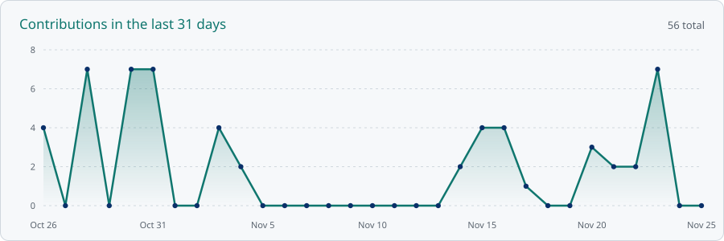</picture>

<b>How this page builds itself</b>

 

Nothing here is a screenshot. Every graphic is an SVG generated by the scripts in [`scripts/`](scripts) and committed back by GitHub Actions, daily and on every push. The portrait in the terminal is my photo redrawn as about 5,900 dots. Actions are pinned to commit SHAs and kept current by Dependabot.

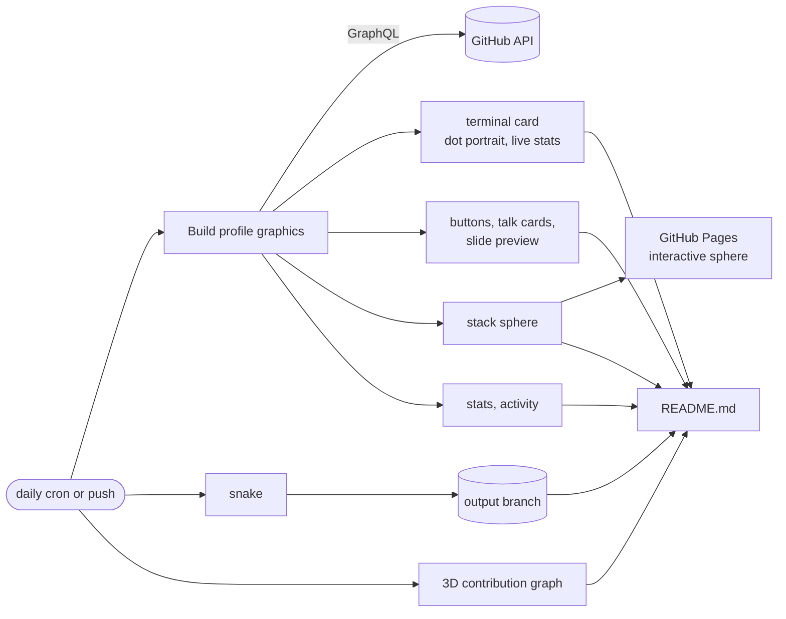

  <picture>
    <source media="(prefers-color-scheme: dark)" srcset="https://raw.githubusercontent.com/mella7/mella7/output/github-snake-dark.svg">
    
  </picture>

<code>kubectl logs -f mella7</code> · built by <a href="scripts">scripts/</a>, refreshed daily by GitHub Actions

