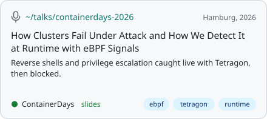
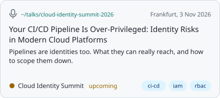
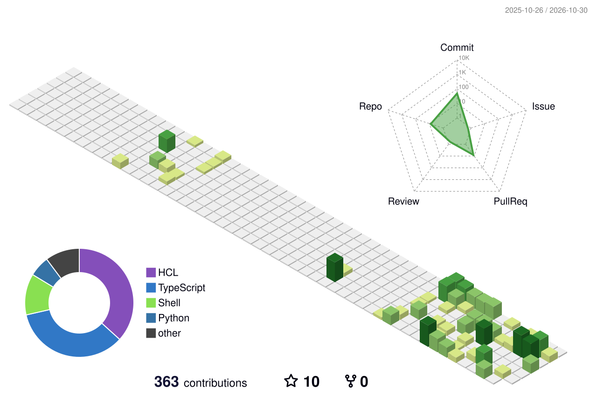
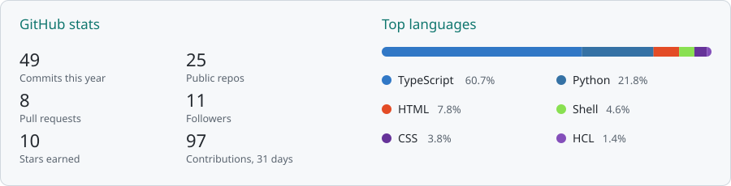
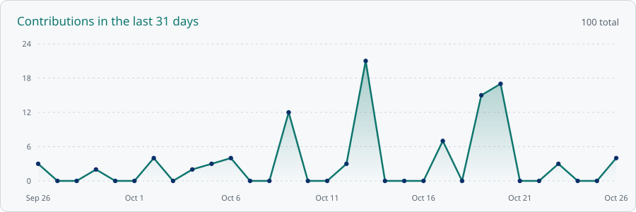
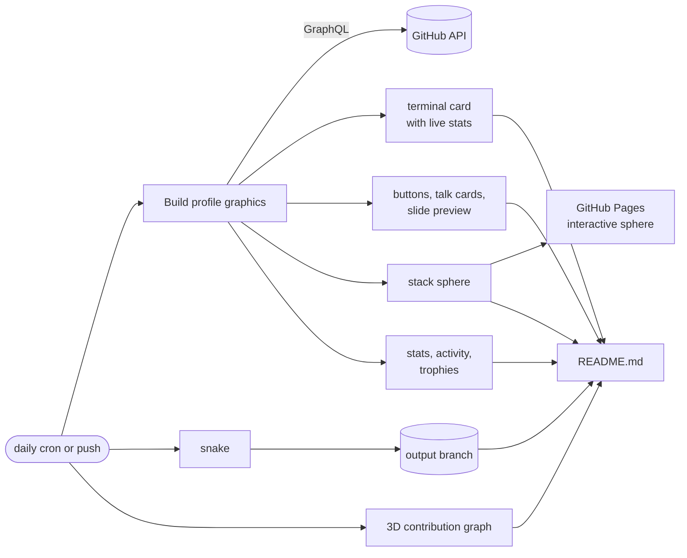

<!-- Reading the source? Every graphic on this page is generated by scripts/ and refreshed by GitHub Actions. -->

<a href="https://mella7.me">
  <picture>
    <source media="(prefers-color-scheme: dark)" srcset="dark_mode.svg">
    
  </picture>
</a>

  <a href="https://www.linkedin.com/in/MellahMedAli"><picture><source media="(prefers-color-scheme: dark)" srcset="assets/buttons/linkedin-dark.svg"></picture></a>
  <a href="https://medium.com/@mellahmohamedali"><picture><source media="(prefers-color-scheme: dark)" srcset="assets/buttons/medium-dark.svg"></picture></a>
  <a href="https://mella7.me"><picture><source media="(prefers-color-scheme: dark)" srcset="assets/buttons/website-dark.svg"></picture></a>
  <a href="mailto:mellah.mohamedali@outlook.com"><picture><source media="(prefers-color-scheme: dark)" srcset="assets/buttons/email-dark.svg"></picture></a>

  <picture><source media="(prefers-color-scheme: dark)" srcset="https://streak-stats.demolab.com/?user=mella7&background=161b22&border=30363d&stroke=30363d&ring=2dd4bf&fire=2dd4bf&currStreakNum=f0f6fc&sideNums=c9d1d9&currStreakLabel=2dd4bf&sideLabels=c9d1d9&dates=8b949e"></picture>

  <picture>
    <source media="(prefers-color-scheme: dark)" srcset="https://raw.githubusercontent.com/mella7/mella7/output/github-snake-dark.svg">
    
  </picture>

## Talks

  
   A few slides from the ContainerDays talk. Click through for the full deck.

  <a href="https://mella7.me/en/talks/containerdays-2026-ebpf"><picture><source media="(prefers-color-scheme: dark)" srcset="assets/talks/containerdays-2026-dark.svg"></picture></a>
  <a href="https://mella7.me/en/talks/cloud-identity-summit-2026-cicd"><picture><source media="(prefers-color-scheme: dark)" srcset="assets/talks/cloud-identity-summit-2026-dark.svg"></picture></a>

## Stack

  <a href="https://mella7.github.io/mella7/"><picture>
    <source media="(prefers-color-scheme: dark)" srcset="assets/stack-sphere-dark.svg">
    
  </picture></a>
   Click the sphere for the interactive version: drag to spin, hover a logo, filter by group.

## GitHub activity

<picture><source media="(prefers-color-scheme: dark)" srcset="profile-3d-contrib/profile-night-rainbow.svg"></picture>

<picture><source media="(prefers-color-scheme: dark)" srcset="assets/stats-dark.svg"></picture>

<picture><source media="(prefers-color-scheme: dark)" srcset="assets/activity-dark.svg"></picture>

  <picture><source media="(prefers-color-scheme: dark)" srcset="assets/trophies-dark.svg"></picture>

<b>How this page builds itself</b>

 

Nothing here is a screenshot. Every graphic is an SVG generated by the scripts in [`scripts/`](scripts) and committed back by GitHub Actions, daily and on every push. Actions are pinned to commit SHAs and kept current by Dependabot.

<code>kubectl logs -f mella7</code> · every graphic here is built by <a href="scripts">scripts/</a> and refreshed daily by GitHub Actions

